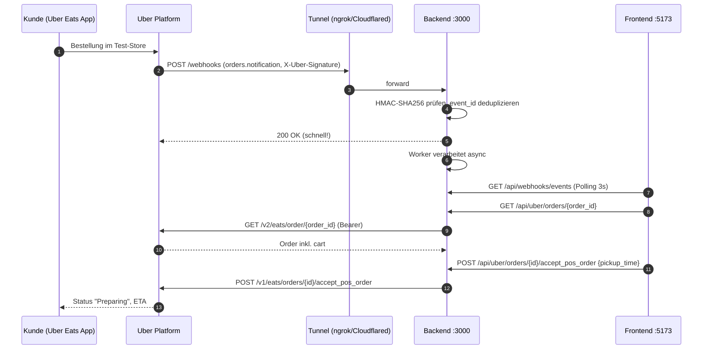
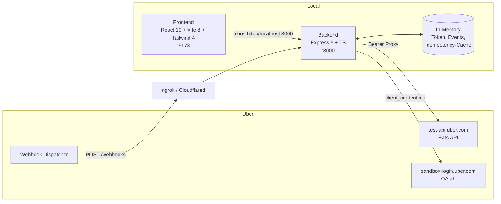

# Knowledge Base – B2B UberEats Local Test App

> **Zweck:** Single Source of Truth für Menschen **und** AI-Agents, die an der Uber-Eats-Integration arbeiten.
> Konsolidiert die Notion-Doku (_B2B Delivery → UberEats_ inkl. aller Unterseiten) und den tatsächlichen Code-Stand dieses Repos.
>
> **Stand:** 2026-10-29 · Notion zuletzt bearbeitet 2026-03-21 · letzter Commit `ad5a156 Moved to idempotency for Event IDs`
>
> **Regel für Agents:** Diese Datei enthält **keine Secrets**. Secrets niemals in Code, Doku, Commits oder Logs schreiben (siehe [§10 Sicherheit](#10-sicherheit--bekannte-risiken)).

---

## Inhaltsverzeichnis

1. [TL;DR](#1-tldr)
2. [Glossar](#2-glossar)
3. [Uber-Developer-Setup (Onboarding)](#3-uber-developer-setup-onboarding)
4. [Test-Stores](#4-test-stores)
5. [Authentifizierung & Scopes](#5-authentifizierung--scopes)
6. [API-Referenz (Store / Menu / Order)](#6-api-referenz)
7. [Webhooks](#7-webhooks)
8. [Architektur der Test-App](#8-architektur-der-test-app)
9. [Lokales Setup & Betrieb](#9-lokales-setup--betrieb)
10. [Sicherheit & bekannte Risiken](#10-sicherheit--bekannte-risiken)
11. [Gap-Analyse: Was wir haben / was fehlt](#11-gap-analyse-was-wir-haben--was-fehlt)
12. [Offene Fragen (zu verifizieren)](#12-offene-fragen-zu-verifizieren)
13. [Quellen](#13-quellen)

---

## 1. TL;DR

- **Was:** Lokale Full-Stack-App (Express-Backend + React/Vite-Frontend), um den **Uber Eats Marketplace API**-Flow (Store, Menu, Order, Webhooks) gegen die **Sandbox** end-to-end zu testen.
- **Business-Kontext:** "Byte2Bite" – B2B-Delivery-Integration. Später Umzug von lokalem Tunnel (ngrok/Cloudflared) auf **AWS** geplant.
- **Kern-Flow:** Kunde bestellt im Test-Store → Uber sendet Webhook `orders.notification` → Backend prüft HMAC-Signatur, dedupliziert per `event_id` → App holt Order-Details → Restaurant akzeptiert (`accept_pos_order`) mit `pickup_time`.
- **Status:** Webhook-Empfang + Signaturprüfung **live verifiziert** (21.03.2026). Store/Menu/Order-Calls in Postman verifiziert. Business-Logik im Worker ist noch **Mock**.
- **Kritisch offen:** Secrets liegen im Git-Repo (GitHub-Remote), Proxy ist über den Tunnel ungeschützt erreichbar → [§10](#10-sicherheit--bekannte-risiken).

---

## 2. Glossar

| Begriff                     | Bedeutung                                                                                                                     |
| --------------------------- | ----------------------------------------------------------------------------------------------------------------------------- |
| **Store ID**                | UUID des Restaurants bei Uber. Wird in Pfaden als `{store_id}` verwendet. Im Webhook = `meta.user_id`.                        |
| **Org UUID**                | UUID der Organisation des Stores. **Nicht** mit Store ID verwechseln.                                                         |
| **Order ID**                | UUID einer Bestellung. Im Webhook = `meta.resource_id`.                                                                       |
| **Event ID**                | `event_id` im Webhook. Eindeutig pro Event → **Idempotency Key**.                                                             |
| **Client Credentials Flow** | OAuth2 Server-to-Server: `client_id` + `client_secret` + `scope` → Bearer Token.                                              |
| **Scope**                   | Berechtigung des Tokens (z. B. `eats.store`). Muss **in der Uber-App aktiviert** _und_ **beim Token-Request angefragt** sein. |
| **Sandbox**                 | `sandbox-login.uber.com` (Auth) + `test-api.uber.com` (API).                                                                  |
| **Modifier Group**          | Auswahlgruppe an einem Artikel (z. B. „Add-milk“). Items darin sind nur über das Hauptprodukt bestellbar.                     |
| **POS**                     | Point of Sale – unsere App agiert als Kassensystem des Restaurants.                                                           |
| **Tunnel**                  | ngrok / Cloudflared – macht `localhost:3000` öffentlich erreichbar, damit Uber Webhooks zustellen kann.                       |

---

## 3. Uber-Developer-Setup (Onboarding)

Reihenfolge, wie sie in Notion dokumentiert und durchgeführt wurde:

1. **App erstellen** auf [developer.uber.com/dashboard](https://developer.uber.com/dashboard).
2. **Redirect URI & Privacy Policy URL** setzen – für Client-Credentials irrelevant, Pflichtfeld → `http://localhost` oder Google-URL genügt.
3. **Scopes aktivieren** (Dashboard → Access Token / Scopes). Siehe [§5.2](#52-scopes).
4. **Client ID & Client Secret** aus dem App-Dashboard kopieren → in `backend/.env` (nie committen).
5. **Test-Stores anfordern** über Uber-Support-Formular (Google Form, Link in Notion-Seite „UberEats“). Support-Case: _„Byte2Bite Uber Eats Support Request for Test Stores (Production Validation)“_, Case-Nr. 54529060.
6. Uber legt die Test-Stores an → sichtbar im [Uber Eats Manager](https://merchants.ubereats.com/manager/stores).
7. **Webhook konfigurieren** (Dashboard → Webhooks): Delivery URL + Signing Key. Siehe [§7](#7-webhooks).
8. **Postman** (optional): Uber-Eats-Collection forken. Siehe [§5.4](#54-postman-setup).

---

## 4. Test-Stores

| Store                       | Store ID                               | Org UUID                               | Adresse                                   | Geo              |
| --------------------------- | -------------------------------------- | -------------------------------------- | ----------------------------------------- | ---------------- |
| **Pizza Love Restaurant**   | `e269b9b3-e859-47b5-a9da-d82ce41139be` | `09b5e8c3-14f5-40c7-ab1d-93305052b8e1` | Bahnhofstraße 25, Berlin-Treptow-Köpenick | 52.4579, 13.5792 |
| **Smash Burger Restaurant** | `94d2c184-b3cf-4a08-8e98-8f0a6a2bdcdd` | `06bcaaf4-9436-41c7-beac-700ea45a4c26` | Voltastraße 1, 13355 Berlin               | 52.5427, 13.3921 |

- **Account Type:** Restaurant
- **Tenancy:** `uber/testing/eats.pizza love` (laut Notion bei **beiden** Stores – vermutlich Copy-Paste, siehe [§12](#12-offene-fragen-zu-verifizieren))
- **Logins:** `pizza+teststore+<owner>@gmail.com`, `smash+teststore+<owner>@gmail.com` – **Passwörter nur in Notion „Test Shops“**, nicht hier.
- **Default im Code:** Pizza Love (`STORE_ID_1`), im Frontend hart kodiert in `StoresView.tsx` / `OrdersView.tsx`.
- **Test-Bestellung aufgeben:** Mit Test-Account in der Uber-Eats-App/Web den Store öffnen und bestellen.

> ⚠️ Die Notion-Seite „Get Store Details“ setzt `store_Id = 06bcaaf4-…` – das ist die **Org UUID** von Smash Burger, nicht die Store ID.

---

## 5. Authentifizierung & Scopes

### 5.1 Token holen (Client Credentials)

```bash
curl -X POST https://sandbox-login.uber.com/oauth/v2/token \
  -F "client_id=$UBER_CLIENT_ID" \
  -F "client_secret=$UBER_CLIENT_SECRET" \
  -F "grant_type=client_credentials" \
  -F "scope=eats.store eats.order eats.store.orders.read"
```

Response:

```json
{
  "access_token": "IA.…",
  "token_type": "Bearer",
  "expires_in": 2592000,
  "scope": "eats.store eats.order …"
}
```

- `expires_in` = **2.592.000 s = 30 Tage**.
- Scopes sind **space-separated**.
- Jeder API-Call: Header `Authorization: Bearer <access_token>`.
- **Wichtig:** Ein Token enthält nur die Scopes, die beim Request angefragt wurden. Fehlt ein Scope → `401/403`. Neues Token mit passenden Scopes holen.

### 5.2 Scopes

| Scope                                         | Wofür                                                           | Quelle                |
| --------------------------------------------- | --------------------------------------------------------------- | --------------------- |
| `eats.store`                                  | Store-Details, Store-Liste, Holiday Hours, Menüs                | Notion + Code         |
| `eats.order`                                  | Order-Details, Accept/Deny/Cancel (laut Frontend-Hinweistexten) | Notion + Code         |
| `eats.store.orders.read`                      | **Get Active Created Orders**, Get Order Details                | Notion (explizit)     |
| `eats.store.status.write`                     | Store online/pausiert setzen                                    | Code                  |
| `eats.store.orders.cancel`                    | Order stornieren                                                | Code (Frontend-Liste) |
| `eats.store.orders.restaurantdelivery.status` | Lieferstatus bei Eigenlieferung                                 | Notion + Code (Liste) |
| `eats.report`                                 | Reports                                                         | Code (Liste)          |
| `eats.pos_provisioning`                       | POS-Provisioning, Store-Liste                                   | Code (Liste)          |

**Backend-Auto-Token** (`autoFetchToken` in [backend/src/routes/uber.ts](backend/src/routes/uber.ts)) fragt an:
`eats.order eats.store eats.store.orders.read eats.store.status.write`

### 5.3 Token-Handling im Backend

- Token wird **global in-memory** gehalten (`currentToken`), gilt für alle Requests.
- `POST /api/uber/auth/token` (Frontend „Auth“-View) **überschreibt** das globale Token mit den dort gewählten Scopes.
- Auto-Refresh nur, wenn Token fehlt oder abgelaufen (60 s Puffer) – **nicht** bei fehlendem Scope.
- Bei Server-Neustart ist das Token weg → wird beim nächsten Call automatisch neu geholt.

### 5.4 Postman-Setup

1. Collection forken: _Uber Eats Marketplace API → Get Started – Marketplace Developer Token API_ (alle Unter-Collections einzeln forken).
2. In der Postman-App eigenen Workspace + Environment anlegen.
3. Environment-Variablen: `base_url = https://test-api.uber.com`, `store_id`, `order_id`, `eats_store_token`.
4. Request **Developer Token Endpoint**: Body = `form-data` mit `client_id`, `client_secret`, `grant_type`, `scope`.
5. Post-Response-Script speichert das Token automatisch:

   ```javascript
   pm.test("Status code is 200", () => pm.response.to.have.status(200));
   const jsonData = pm.response.json();
   if (jsonData.access_token) {
     pm.environment.set("eats_store_token", jsonData.access_token);
   }
   ```

6. In jedem weiteren Request: _Authorization → Bearer Token → `{{eats_store_token}}`_.

> Die Postman-Collection und die `openapi.json` (Store API Suite) liegen **nicht** in diesem Repo, sondern unter
> `/Users/sultankhan/DevOps/B2B/B2B Delivery/delivery-dashboard/OpenApi UberEats`.

---

## 6. API-Referenz

**Base URL Sandbox:** `https://test-api.uber.com` · **Backend-Proxy-Prefix:** `http://localhost:3000/api/uber`

Legende Status: ✅ verifiziert (Notion/Postman-Screenshot) · 🟡 im Code, nicht dokumentiert verifiziert · ❌ fehlt · ⚠️ Pfad-Abweichung

### 6.1 Store API

| Funktion             | Methode    | Uber-Pfad (Code)                           | Backend-Route                     | Scope                     | Status                                                     |
| -------------------- | ---------- | ------------------------------------------ | --------------------------------- | ------------------------- | ---------------------------------------------------------- |
| Stores auflisten     | GET        | `/v1/eats/stores`                          | `/stores`                         | `eats.store`              | ⚠️ Notion: `/v1/delivery/stores`                           |
| Store-Details        | GET        | `/v1/eats/stores/{store_id}`               | `/stores/:store_id`               | `eats.store`              | ✅ (Postman) ⚠️ Notion-Overview: `/v1/delivery/store/{id}` |
| Store-Status lesen   | GET        | `/v1/eats/store/{store_id}/status`         | `/stores/:store_id/status`        | `eats.store`              | ⚠️ Notion: `/v1/delivery/store/{id}/status`                |
| Store-Status setzen  | POST       | `/v1/eats/store/{store_id}/status`         | `/stores/:store_id/status`        | `eats.store.status.write` | 🟡                                                         |
| Holiday Hours lesen  | GET        | `/v1/eats/stores/{store_id}/holiday-hours` | `/stores/:store_id/holiday-hours` | `eats.store`              | 🟡                                                         |
| Holiday Hours setzen | POST       | `/v1/eats/stores/{store_id}/holiday-hours` | `/stores/:store_id/holiday-hours` | `eats.store`              | ✅ (Test: geschlossen 16.03.2026 ganztägig)                |
| Store-Details ändern | PATCH/POST | `/v1/…/store/{store_id}`                   | –                                 | `eats.store`              | ❌ nicht im Backend                                        |

> Doku-Link für Holiday Hours: `developer.uber.com/docs/eats/references/api/v1/post-eats-stores-storeid-holidayhours`

### 6.2 Menu API

| Funktion         | Methode | Uber-Pfad                                          | Backend-Route                            | Scope        | Status |
| ---------------- | ------- | -------------------------------------------------- | ---------------------------------------- | ------------ | ------ |
| Menü lesen       | GET     | `/v2/eats/stores/{store_id}/menus`                 | `/stores/:store_id/menus`                | `eats.store` | ✅     |
| Menü hochladen   | PUT     | `/v2/eats/stores/{store_id}/menus`                 | `/stores/:store_id/menus`                | `eats.store` | ✅     |
| Menü-Item ändern | POST    | `/v2/eats/stores/{store_id}/menus/items/{item_id}` | `/stores/:store_id/menus/items/:item_id` | `eats.store` | ✅     |

**Upload Menu – Regeln (aus Notion):**

- **Überschreibt das komplette Menü** (alle Artikel, Kategorien, Modifier Groups). Kein Merge.
- **Preise in Minor Units** (Cent): `"price": 130` = 1,30 €.
- Struktur: `menus[]` → `category_ids[]` → `categories[]` → `entities[]` (Items) → `items[]` → `modifier_group_ids` → `modifier_groups[]`.
- **Hauptartikel** (bestellbar) hängen an einer Kategorie. Beispiel:
  - Drinks: `Coffee`, `Tea`
  - Snacks: `Muffin` („Fresh-baked muffin“)
  - Sandwiches: `Chicken sandwich`
- **Modifier-Items** sind nur über eine Modifier Group erreichbar (erscheinen nach Klick auf Hauptprodukt):
  - `Sugar` in `Add-sugar` (max 2), `Milk` in `Add-milk`, `Blueberry` / `Chocolate deluxe` in `Choose-flavor` (max 1)
- Kontextabhängige Preise/Mengen über `price_info.overrides` / `quantity_info.overrides` mit `context_type: "MODIFIER_GROUP"`, `context_value: "<group-id>"`.
- Übersetzungen: `title.translations.<locale>` – im Beispiel `en_us`, beim Update `en`. Frontend liest `en`, `en_us`, `en-us`, `en-US`, `de`.
- `tax_info.tax_rate` (z. B. `8`) bzw. `vat_rate_percentage`.

**Update Menu Item – Beispiel-Body** (gezielt Preis, Ausverkauft, Beschreibung, Optionen ändern):

```json
{
  "id": "Coffee",
  "title": { "translations": { "en": "Coffee" } },
  "description": { "translations": { "en": "Deliciously roasted beans" } },
  "price_info": { "price": 300, "overrides": [] },
  "suspension_info": {
    "suspension": { "suspend_until": 8640000000, "reason": "sold out" },
    "overrides": []
  },
  "modifier_group_ids": { "ids": ["Add-milk", "Add-sugar"], "overrides": [] },
  "tax_info": { "tax_rate": 8 }
}
```

`suspension_info.suspension.suspend_until` = Unix-Zeit bis wann ausverkauft (sehr großer Wert = unbegrenzt).

### 6.3 Order API

| Funktion                      | Methode | Uber-Pfad (Code)                                       | Backend-Route                         | Scope                                         | Status                                                  |
| ----------------------------- | ------- | ------------------------------------------------------ | ------------------------------------- | --------------------------------------------- | ------------------------------------------------------- |
| Aktive neue Orders            | GET     | `/v1/eats/stores/{store_id}/created-orders`            | `/stores/:store_id/created-orders`    | `eats.store.orders.read`                      | ✅                                                      |
| Order-Details                 | GET     | `/v2/eats/order/{order_id}`                            | `/orders/:order_id`                   | `eats.store.orders.read` / `eats.order`       | ✅ (Cart-Objekt enthält bestellte Artikel)              |
| Order akzeptieren             | POST    | `/v1/eats/orders/{order_id}/accept_pos_order`          | `/orders/:order_id/accept_pos_order`  | `eats.order`                                  | ✅                                                      |
| Order ablehnen                | POST    | `/v1/eats/orders/{order_id}/deny_pos_order`            | `/orders/:order_id/deny`              | `eats.order`                                  | 🟡                                                      |
| Order stornieren              | POST    | `/v1/eats/orders/{order_id}/cancel`                    | `/orders/:order_id/cancel`            | `eats.store.orders.cancel` / `eats.order`     | ✅ ⚠️ Notion-Overview: `/v1/delivery/order/{id}/cancel` |
| Order ready                   | POST    | `/v1/delivery/order/{order_id}/ready`                  | `/orders/:order_id/ready`             | ?                                             | 🟡 nicht in Notion                                      |
| Ready-Time ändern             | POST    | `/v1/delivery/order/{order_id}/update-ready-time`      | `/orders/:order_id/update-ready-time` | ?                                             | 🟡 nicht in Notion                                      |
| Lieferstatus (Eigenlieferung) | POST    | `/v1/eats/orders/{order_id}/restaurantdelivery/status` | –                                     | `eats.store.orders.restaurantdelivery.status` | ❌ nicht im Backend                                     |

> **Hinweis aus Notion:** Der erste Order-Details-Endpoint war falsch, korrekt ist **`/v2/eats/order/{order_id}`**.

**Accept Order – Body:**

```json
{
  "pickup_time": 1773441300,
  "order_pickup_instructions": "Bitte am Hintereingang klingeln"
}
```

- `pickup_time` = **Unix-Sekunden**, wann das Essen abholbereit ist (Frontend-Default: jetzt + 30 min).
- `order_pickup_instructions` = Freitext an den Kurier.
- **Wirkung (beobachtet 13.03.2026):**
  - Kurier: kommt zur `pickup_time` (z. B. 23:55 = Handover-Zeit).
  - Kunde: sieht von Uber berechnete ETA = `pickup_time` + Fahrzeit (z. B. 00:10).
  - Uber zeigt zusätzlich eine Worst-Case-/Puffer-Zeit (z. B. 00:55).

**Update Delivery Status:** Nur relevant, wenn das Restaurant **eigene Fahrer** nutzt (_Not Uber-coordinated delivery_). Bei Uber-Kurieren nicht nötig.

### 6.4 End-to-End Order-Flow



Alternative ohne Webhook (Polling): `GET /v1/eats/stores/{store_id}/created-orders` → liefert alle Orders im Status `CREATED`.

---

## 7. Webhooks

### 7.1 Konfiguration im Uber Dashboard

- **Delivery URL:** `https://<tunnel-domain>/webhooks` (aktuell ngrok Static Domain `https://ependymary-lannie-conscientious.ngrok-free.dev/webhooks`).
- **Signing Key:** = **Client Secret** der App (laut Notion).
- Bei wechselnder Tunnel-URL (Cloudflared Quick Tunnel, ngrok ohne Static Domain) muss die URL **jedes Mal neu** eingetragen werden.
- Webhook-Config-ID: `eats-restaurant-order-experience.order-webhooks`.

### 7.2 Request von Uber (real empfangen am 21.03.2026)

**Headers (relevant):**

| Header                                | Wert/Bedeutung                                                                               |
| ------------------------------------- | -------------------------------------------------------------------------------------------- |
| `Content-Type`                        | `application/json`                                                                           |
| `User-Agent`                          | `Go-http-client/1.1`                                                                         |
| `X-Uber-Signature`                    | HMAC-SHA256 (hex) über Raw Body mit Signing Key → **verifiziert ✅**                         |
| `X-Uber-Signature-New`                | Anderer Wert, Algorithmus/Key **unbekannt** (siehe [§12](#12-offene-fragen-zu-verifizieren)) |
| `X-Environment` / `X-Api-Environment` | `production` (!)                                                                             |
| `X-Forwarded-Host/-For/-Proto`        | vom Tunnel gesetzt                                                                           |

**Body:**

```json
{
  "event_id": "352b48d5-a21d-5114-bc79-d148c1acb59e",
  "event_type": "orders.notification",
  "event_time": 1774122733000,
  "resource_href": "https://api.uber.com/v2/eats/order/c7df321b-251c-4bdc-9bdf-90c43867c929",
  "meta": {
    "user_id": "e269b9b3-e859-47b5-a9da-d82ce41139be",
    "resource_id": "c7df321b-251c-4bdc-9bdf-90c43867c929",
    "status": "pos"
  },
  "webhook_meta": {
    "client_id": "<UBER_CLIENT_ID>",
    "webhook_config_id": "eats-restaurant-order-experience.order-webhooks",
    "webhook_msg_timestamp": 1774122734,
    "webhook_msg_uuid": "88e339df-99e7-5810-9aa6-13acdefa8cfc"
  }
}
```

| Feld                                 | Bedeutung                                                    |
| ------------------------------------ | ------------------------------------------------------------ |
| `meta.user_id`                       | **Store ID**                                                 |
| `meta.resource_id`                   | **Order ID**                                                 |
| `resource_href`                      | Direkt-URL zum Order-Details-Endpoint (Host `api.uber.com`!) |
| `event_time`                         | **Millisekunden**                                            |
| `webhook_meta.webhook_msg_timestamp` | **Sekunden**                                                 |

### 7.3 Signaturprüfung

```
expected = hex( HMAC_SHA256( key = SIGNING_KEY, message = RAW_BODY_BYTES ) )
valid    = timingSafeEqual(expected, header["X-Uber-Signature"])
```

- **Raw Body** verwenden – nicht `JSON.stringify(req.body)` (Whitespace/Key-Reihenfolge würde Signatur brechen). Im Code: `express.json({ verify })` speichert `req.rawBody`.
- Key-Auflösung im Code ([backend/src/middleware/verifyUberWebhook.ts](backend/src/middleware/verifyUberWebhook.ts)):
  `UBER_WEBHOOK_SIGNING_KEY` → `UBER_WEBHOOK_SECRET` → `UBER_CLIENT_SECRET`.
- Akzeptiert, wenn **einer** der Header `X-Uber-Signature` / `X-Uber-Signature-New` passt.
- Ungültig/fehlend → `401`. Kaputtes JSON → `400`.

### 7.4 Verarbeitung (Idempotenz + Worker)

1. `verifyUberWebhook` → Signatur ok.
2. Pflichtfelder `event_id`, `event_type` → sonst `400`.
3. `idempotencyService.acquireLock(event_id)` → Duplikat? → `200 "Already processed"` (stoppt Uber-Retries).
4. `saveEvent` (Status `pending`) → `webhookWorker.enqueue` → sofort `200`.
5. Worker (EventEmitter, async): `processing` → Handler → `completed` / `failed`.

| `event_type`          | Handler                   | Status                      |
| --------------------- | ------------------------- | --------------------------- |
| `orders.notification` | `handleOrderNotification` | Mock (1,5 s Sleep, nur Log) |
| `orders.cancel`       | `handleOrderCancel`       | Mock (0,8 s Sleep, nur Log) |
| alle anderen          | Default: nur Log          | –                           |

> **Uber-Anforderung:** Schnell mit `200` antworten (Code-Kommentar: < 2000 ms), sonst Retries. Event IDs speichern, da Uber dieselbe Order mehrfach senden kann.

### 7.5 Webhook lokal testen

| Methode                  | Befehl                                                                                                                           |
| ------------------------ | -------------------------------------------------------------------------------------------------------------------------------- |
| Signatur-Selbsttest (TS) | `cd backend && npx ts-node src/verify-webhook.ts` (sendet 3 Requests an `/webhooks`: alter Header, neuer Header, ungültig → 401) |
| Flask-Debug-Receiver     | `pip install flask && python3 ngrokTestWebhook.py` (Port 5001, loggt Header/Body/Signatur)                                       |
| curl Smoke-Test          | `curl -X POST http://localhost:3000/webhooks -H 'Content-Type: application/json' -d '{"test":"hello"}'` → erwartet `401`         |
| Backend-Config prüfen    | `GET http://localhost:3000/api/webhooks/self-test`                                                                               |
| ngrok-Inspector          | `http://127.0.0.1:4040` (Requests ansehen & replayen)                                                                            |
| Echt                     | Test-Bestellung im Store aufgeben → Webhook-Tab im Frontend                                                                      |

---

## 8. Architektur der Test-App



### 8.1 Backend ([backend/src](backend/src))

| Datei                                                                          | Verantwortung                                                                               |
| ------------------------------------------------------------------------------ | ------------------------------------------------------------------------------------------- |
| [index.ts](backend/src/index.ts)                                               | Express-Setup, CORS, Raw-Body-Capture, Routing, `/health`, `/api/webhooks/self-test`        |
| [routes/uber.ts](backend/src/routes/uber.ts)                                   | OAuth-Token, generischer Proxy `proxyRequest` (Latenz/Status-Meta), Store/Menu/Order-Routen |
| [routes/webhooks.ts](backend/src/routes/webhooks.ts)                           | `POST /` Ingestion, `GET /events`, `DELETE /events`                                         |
| [middleware/verifyUberWebhook.ts](backend/src/middleware/verifyUberWebhook.ts) | HMAC-Prüfung, JSON aus Raw Body parsen                                                      |
| [services/idempotencyService.ts](backend/src/services/idempotencyService.ts)   | Dedupe-Cache (max 5000, LRU-ähnlich), Event-Store (max 500)                                 |
| [workers/webhookWorker.ts](backend/src/workers/webhookWorker.ts)               | Async Event-Router (EventEmitter)                                                           |
| [verify-webhook.ts](backend/src/verify-webhook.ts)                             | Test-Script für Signaturprüfung                                                             |

**Routing-Mounts:** `webhookRoutes` ist auf `/api/webhooks`, `/webhooks` **und** `/` gemountet → `POST /`, `POST /webhooks`, `POST /api/webhooks` nehmen alle Webhooks an; `GET /events` existiert dreifach.

**Proxy-Response-Format** (alle `/api/uber/*`):

```json
{ "data": { /* Uber-Response */ }, "meta": { "status": 200, "latency": 123 } }
// Fehler:
{ "error": { /* Uber-Error */ }, "meta": { "status": 403, "latency": 80 } }
```

**Header-Override:** `x-uber-base-url` überschreibt die Base URL pro Request (genutzt in `StoresView`). → Sicherheitsrisiko, siehe §10.

### 8.2 Frontend ([frontend/src](frontend/src))

| View          | Inhalt                                                                                    |
| ------------- | ----------------------------------------------------------------------------------------- |
| `Dashboard`   | Übersicht                                                                                 |
| `AuthView`    | Scope-Auswahl (Checkboxen) + Token holen                                                  |
| `StoresView`  | Base-URL + Store-ID-Eingabe; Stores, Details, Status (GET/POST), Holiday Hours (GET/POST) |
| `MenusView`   | Menü lesen + visuell rendern (Kategorien, Items, Modifier), Item-Editor, Menü-Upload      |
| `OrdersView`  | Created Orders (Karten), Details, Accept, Ready, Update-Ready-Time, Cancel, Deny          |
| `WebhookView` | Live-Timeline (Polling 3 s), Order-Details pro Event laden, Events löschen                |

- `EndpointPanel` = wiederverwendbare „Swagger-artige“ Request/Response-Komponente.
- API-Client: [frontend/src/lib/api.ts](frontend/src/lib/api.ts) mit hart kodiertem `baseURL: http://localhost:3000`.

---

## 9. Lokales Setup & Betrieb

### 9.1 Voraussetzungen

- Node.js ≥ 18 (Express 5 / Vite 8), npm
- ngrok-Account (Static Domain) **oder** `cloudflared`
- Python 3 + Flask (nur für `ngrokTestWebhook.py`)
- Uber-Developer-App mit aktivierten Scopes + Test-Stores

### 9.2 Environment (`backend/.env`)

Backend lädt `.env` aus dem **Arbeitsverzeichnis** (`dotenv.config()`) → `npm run dev` in `backend/` liest **`backend/.env`**. Die Root-`.env` wird vom Backend nicht gelesen.

| Variable                         | Pflicht | Default                                         | Verwendet in                   | Beschreibung                           |
| -------------------------------- | ------- | ----------------------------------------------- | ------------------------------ | -------------------------------------- |
| `UBER_CLIENT_ID`                 | ✅      | –                                               | uber.ts                        | App Client ID                          |
| `UBER_CLIENT_SECRET`             | ✅      | –                                               | uber.ts, Middleware (Fallback) | App Client Secret                      |
| `UBER_BASE_URL`                  | –       | `https://test-api.uber.com`                     | uber.ts                        | API Host                               |
| `UBER_AUTH_URL`                  | –       | `https://sandbox-login.uber.com/oauth/v2/token` | uber.ts                        | Token-Endpoint                         |
| `UBER_WEBHOOK_SIGNING_KEY`       | –       | –                                               | Middleware, self-test          | Höchste Priorität für Signaturprüfung  |
| `UBER_WEBHOOK_SECRET`            | –       | –                                               | Middleware                     | 2. Priorität (aktuell = Client Secret) |
| `PORT`                           | –       | `3000`                                          | index.ts                       | Backend-Port                           |
| `STORE_ID_1/2`, `STORE_NAME_1/2` | –       | –                                               | **nirgends im Code**           | Nur Doku/Referenz                      |
| `UBER_WEBHOOK_URL`               | –       | –                                               | **nirgends im Code**           | Nur Doku/Referenz                      |
| `FORWARD_WEBHOOK_URL`            | –       | –                                               | webhooks.ts (Relay)            | Optional: leitet jeden geprüften Webhook unverändert (Raw Body + `X-Uber-Signature*`) per POST an die B2B-Core weiter, z. B. `https://<core-tunnel>/api/v1/public/delivery/uber/webhook` (B2B-040). Uber kennt nur **eine** Delivery-URL pro App; die Test-App bleibt davor, Core prüft die Signatur erneut. Fire-and-forget, verzögert die Antwort an Uber nicht |

### 9.3 Starten

```bash
# Terminal 1 – Backend
cd backend && npm install && npm run dev        # http://localhost:3000

# Terminal 2 – Frontend
cd frontend && npm install && npm run dev       # http://localhost:5173

# Terminal 3 – Tunnel (eine Variante)
ngrok config add-authtoken <NGROK_TOKEN>        # einmalig
ngrok http --domain=ependymary-lannie-conscientious.ngrok-free.dev 3000
# oder
cloudflared tunnel --url http://localhost:3000  # zufällige *.trycloudflare.com URL → im Uber Dashboard neu eintragen
```

**Smoke-Checks:**

```bash
curl http://localhost:3000/health
curl http://localhost:3000/api/webhooks/self-test
```

### 9.4 Typische Fehler

| Symptom                                             | Ursache                                               | Lösung                                                                        |
| --------------------------------------------------- | ----------------------------------------------------- | ----------------------------------------------------------------------------- |
| `401/403` bei API-Call                              | Scope fehlt im Token oder nicht in App aktiviert      | Scope im Dashboard aktivieren **und** neues Token mit Scope holen (Auth-View) |
| Nach Auth-View-Call plötzlich 403 bei anderen Calls | Globales Token wurde mit weniger Scopes überschrieben | Im Auth-View alle benötigten Scopes wählen                                    |
| Webhook `401 Invalid signature`                     | Falscher Signing Key oder Body verändert              | Signing Key = Client Secret prüfen; Raw Body nutzen                           |
| Webhook kommt nicht an                              | Tunnel-URL im Dashboard veraltet / Tunnel aus         | URL aktualisieren, ngrok-Inspector `:4040` prüfen                             |
| Port 3000 belegt                                    | Anderer Prozess (z. B. Flask)                         | Port wechseln (`PORT=…`, Tunnel anpassen)                                     |
| Order-Details 404                                   | Falscher Endpoint (v1)                                | `/v2/eats/order/{order_id}`                                                   |
| Events nach Neustart weg                            | In-Memory-Store                                       | erwartet – Persistenz fehlt                                                   |

---

## 10. Sicherheit & bekannte Risiken

> Priorität: 🔴 kritisch · 🟠 hoch · 🟡 mittel

| #   | Prio | Befund                                                                                                                                        | Ort                                                               | Empfehlung                                                                                                                                                                                                                              |
| --- | ---- | --------------------------------------------------------------------------------------------------------------------------------------------- | ----------------------------------------------------------------- | --------------------------------------------------------------------------------------------------------------------------------------------------------------------------------------------------------------------------------------- |
| S1  | 🔴   | **`.env`, `backend/.env` und `.env.example` mit echten Credentials sind in Git committed**; Remote: GitHub `Sultan0725-khan/UberEats-TestApp` | Repo-Root, `backend/`                                             | Client Secret im Uber Dashboard **rotieren**; Root-`.gitignore` anlegen (`.env`, `node_modules`, `dist`); `git rm --cached`; `.env.example` nur Platzhalter; Git-History bereinigen (z. B. `git filter-repo`) falls Repo öffentlich war |
| S2  | 🔴   | Client Secret **hart kodiert**                                                                                                                | `backend/src/verify-webhook.ts` (Fallback), `ngrokTestWebhook.py` | Nur aus Env lesen, kein Fallback                                                                                                                                                                                                        |
| S3  | 🔴   | Client Secret, Access Token, Store-Passwörter **im Klartext in Notion** (auch als Query-Parameter in „API Calls Overview“)                    | Notion                                                            | Nach Rotation aus Notion entfernen, Passwort-Manager nutzen                                                                                                                                                                             |
| S4  | 🔴   | **Gesamter Proxy `/api/uber/*` ist über den Tunnel öffentlich erreichbar**, ohne Auth, mit `cors()` = `*`                                     | index.ts                                                          | Tunnel nur auf Webhook-Pfad routen oder Proxy per API-Key/Basic-Auth schützen; CORS auf `http://localhost:5173` beschränken                                                                                                             |
| S5  | 🔴   | **SSRF / Token-Leak:** Header `x-uber-base-url` wird ungeprüft übernommen → Bearer Token wird an beliebigen Host gesendet                     | uber.ts `proxyRequest`                                            | Allowlist (`test-api.uber.com`, `api.uber.com`) oder Header entfernen                                                                                                                                                                   |
| S6  | 🟠   | `GET/DELETE /events` öffentlich → Order-/Store-Daten lesbar, Events löschbar (inkl. Idempotency-Cache → Doppelverarbeitung)                   | webhooks.ts                                                       | Nur lokal / mit Auth                                                                                                                                                                                                                    |
| S7  | 🟠   | Jeder Request-Body wird geloggt (`RAW BODY CAPTURED`) → PII in Logs                                                                           | index.ts                                                          | Nur im Debug-Modus, maskiert                                                                                                                                                                                                            |
| S8  | 🟡   | Webhook-Router auch auf `/` gemountet → größere Angriffsfläche                                                                                | index.ts                                                          | Nur `/webhooks`                                                                                                                                                                                                                         |
| S9  | 🟡   | `node_modules/` (≈1.700 Dateien) und veraltetes `backend/dist/` committed                                                                     | Repo                                                              | Aus Git entfernen                                                                                                                                                                                                                       |
| S10 | 🟡   | Kein Replay-Schutz über Timestamp (`webhook_msg_timestamp`)                                                                                   | Middleware                                                        | Events älter als X Minuten ablehnen                                                                                                                                                                                                     |

---

## 11. Gap-Analyse: Was wir haben / was fehlt

### 11.1 ✅ Was wir haben

**Uber-Setup**

- Developer-App mit Client Credentials, Scopes konfiguriert
- 2 Test-Stores (Pizza Love, Smash Burger) von Uber-Support bereitgestellt
- Webhook im Dashboard konfiguriert (ngrok Static Domain)
- Postman-Collection geforkt, Token-Auto-Save-Script

**Verifizierte API-Calls (Postman/App)**

- Token holen (Sandbox)
- Store-Details, Holiday Hours setzen
- Menü lesen, hochladen, Item updaten
- Created Orders, Order-Details (v2), Accept Order, Cancel Order

**Code**

- Express-Proxy mit Auto-Token, Latenz-/Status-Meta
- Webhook-Ingestion mit HMAC-SHA256 (timing-safe), zwei Signatur-Header
- Idempotenz per `event_id`, async Worker mit Status-Tracking
- React-UI: Auth, Stores, Menus (inkl. visuellem Renderer + Item-Editor), Orders, Webhook-Timeline mit Order-Detail-Nachladen
- Test-Utilities: `verify-webhook.ts`, `ngrokTestWebhook.py`, `test-uber.js`

**Doku**

- Notion-Seitenbaum (Onboarding, Postman, Endpoints, Webhook, Cloudflared)
- README, diese Knowledge Base

### 11.2 ❌ Was fehlt

**Sicherheit (zuerst!)** → siehe [§10](#10-sicherheit--bekannte-risiken) S1–S10.

**Funktional**

| #   | Gap                        | Details                                                                                                                                          |
| --- | -------------------------- | ------------------------------------------------------------------------------------------------------------------------------------------------ |
| F1  | Worker-Business-Logik      | Handler sind Mocks. Fehlt: Order-Details automatisch holen, speichern, Auto-Accept/Deny-Regel, Benachrichtigung                                  |
| F2  | Persistenz                 | Token, Events, Idempotency-Cache nur in-memory → Verlust bei Neustart; Doppelverarbeitung nach Restart möglich. Für AWS: DynamoDB/Redis/Postgres |
| F3  | Echte Queue / Retry / DLQ  | EventEmitter ohne Retry; `failed` wird nur markiert. Für AWS: SQS + DLQ                                                                          |
| F4  | Weitere Event-Types        | Nur `orders.notification` + `orders.cancel`. Weitere Uber-Events (Store-, Failure-, Scheduled-Events) laut Doku prüfen und behandeln             |
| F5  | Restaurant Delivery Status | `POST /v1/eats/orders/{id}/restaurantdelivery/status` nicht implementiert (nur für Eigenlieferung)                                               |
| F6  | Store-Details ändern       | Update-Store-Endpoint nicht im Backend                                                                                                           |
| F7  | Token pro Scope-Set        | Globales Token wird überschrieben; kein Refresh bei 401/403                                                                                      |
| F8  | Store-Auswahl aus Config   | `STORE_ID_*` aus Env werden nicht genutzt; Frontend hart kodiert. Endpoint `/api/config/stores` + Dropdown                                       |
| F9  | Frontend-Config            | `baseURL` hart kodiert → `VITE_API_URL`                                                                                                          |
| F10 | Accept-Timeout-Handling    | Keine Überwachung, ob eine Order rechtzeitig akzeptiert wurde (Uber storniert sonst automatisch – Frist in Doku prüfen)                          |

**Qualität / Betrieb**

| #   | Gap                                                                                                                      |
| --- | ------------------------------------------------------------------------------------------------------------------------ |
| Q1  | Keine automatisierten Tests (Unit für Middleware/Idempotenz, Integration für Webhook-Flow)                               |
| Q2  | Kein Lint/Format für Backend; kein CI (GitHub Actions)                                                                   |
| Q3  | Kein Dockerfile / docker-compose; kein AWS-Deployment (geplant laut Notion)                                              |
| Q4  | Kein strukturiertes Logging / Monitoring / Alerting                                                                      |
| Q5  | Keine Input-Validierung der Proxy-Parameter (`store_id`, `order_id` → UUID prüfen)                                       |
| Q6  | Postman-Collection & `openapi.json` nicht im Repo versioniert                                                            |
| Q7  | `test-uber.js` lädt `.env` aus altem Pfad `/Users/sultankhan/DevOps/B2B/B2B UberEats/.env`                               |
| Q8  | `frontend/test_menu_error.js` + `.cjs` Duplikate                                                                         |
| Q9  | Root-`.env` enthält Client ID und Secret **vertauscht** (Längen 40/32 statt 32/40) – wird aber vom Backend nicht gelesen |
| Q10 | `/api/webhooks/self-test` berücksichtigt `UBER_WEBHOOK_SECRET` nicht → zeigt falschen `keyUsed`                          |

**Dokumentation**

| #   | Gap                                                                                            |
| --- | ---------------------------------------------------------------------------------------------- |
| D1  | Pfad-Abweichungen Notion ↔ Code (§6, ⚠️) klären und Notion-„API Calls Overview“ korrigieren    |
| D2  | Notion „Get Store Details“: Org UUID als Store ID eingetragen                                  |
| D3  | Response-Beispiele (Order-Details inkl. `cart`, Created Orders) als JSON statt nur Screenshots |
| D4  | Fehlercodes/Rate Limits der Uber API nicht dokumentiert                                        |
| D5  | Upload-Menu-Beispiel: Muffin `price: 13` (= 0,13 €) vermutlich Tippfehler für `130`            |

### 11.3 Empfohlene Reihenfolge

1. **S1–S5** (Secrets rotieren, Repo bereinigen, Proxy absichern)
2. **F2 + F3** Persistenz & Queue (Grundlage für AWS)
3. **F1 + F10** echte Order-Verarbeitung inkl. Accept-Logik
4. **Q1–Q3** Tests, CI, Container
5. **D1–D5** Doku-Abgleich

---

## 12. Offene Fragen (zu verifizieren)

| #   | Frage                                                                                                                                             | Warum relevant                                                                                    |
| --- | ------------------------------------------------------------------------------------------------------------------------------------------------- | ------------------------------------------------------------------------------------------------- |
| O1  | Gilt `/v1/eats/stores…` oder `/v1/delivery/store…` für Store-Calls?                                                                               | Notion-Overview und Code widersprechen sich                                                       |
| O2  | Wie wird `X-Uber-Signature-New` berechnet (anderer Key? anderes Schema)?                                                                          | Wert ≠ HMAC(Client Secret); aktuell nur alter Header verifiziert                                  |
| O3  | Warum kommen Webhooks mit `X-Environment: production` und `resource_href` auf `api.uber.com`, während API-Calls gegen `test-api.uber.com` laufen? | Test-Stores sind „Production Validation“-Stores – evtl. muss Order-Details gegen Prod-Host laufen |
| O4  | Welche Scopes genau für Accept/Deny/Cancel/Ready?                                                                                                 | Frontend-Hinweise nennen teils `eats.order`, Notion `eats.store.orders.read`                      |
| O5  | Sind `/v1/delivery/order/{id}/ready` und `/update-ready-time` gültige Eats-Endpoints?                                                             | Im Code, aber in keiner Notion-Seite verifiziert                                                  |
| O6  | Tenancy von Smash Burger wirklich `…pizza love`?                                                                                                  | Wahrscheinlich Copy-Paste                                                                         |
| O7  | Frist für Accept/Deny, bevor Uber automatisch storniert?                                                                                          | Relevant für Worker-Logik (F10)                                                                   |
| O8  | Ist das GitHub-Repo öffentlich?                                                                                                                   | Bestimmt Dringlichkeit von S1                                                                     |

---

## 13. Quellen

**Notion (B2B Delivery → UberEats)**

| Seite                                                                                                                                                                   | Inhalt                                      |
| ----------------------------------------------------------------------------------------------------------------------------------------------------------------------- | ------------------------------------------- |
| [UberEats](https://app.notion.com/p/302ec07c0cb68099a3e2f7b22877374e)                                                                                                   | Onboarding, App, Token, Support             |
| [Test Shops](https://app.notion.com/p/31cec07c0cb6806592fbc9fc4ae914f6)                                                                                                 | Store-Daten & Logins                        |
| [WebHook](https://app.notion.com/p/323ec07c0cb6809fb182fcf0026eea7c)                                                                                                    | Dashboard-Setup, ngrok-Test, echter Payload |
| ↳ [Cloudflared](https://app.notion.com/p/32aec07c0cb680feb90affd518a6596e)                                                                                              | Quick Tunnel                                |
| [Postman Setup – Access Token](https://app.notion.com/p/31bec07c0cb6804dbba1f0900fe57909)                                                                               | Collection, Token-Script                    |
| ↳ [API Calls Overview](https://app.notion.com/p/323ec07c0cb68057877adb3d214ac26e)                                                                                       | Endpoint-Liste                              |
| ↳ [Store](https://app.notion.com/p/322ec07c0cb6805ea808c689599a92f2) → Get Store Details, Marketplace Store OpenAPI, Set Holiday Hours                                  |                                             |
| ↳ [Menu](https://app.notion.com/p/322ec07c0cb68093ab56da64b617d503) → Get Menu, Upload Menu, Update Menu Item                                                           |                                             |
| ↳ [Order](https://app.notion.com/p/322ec07c0cb680cc83b3f0a9cf82adc2) → Get Active Created Orders, Get Order Details, Accept Order, Update Delivery Status, Cancel Order |                                             |
| [Local Test App Project Documentation](https://app.notion.com/p/32aec07c0cb68027b9b0c8838a0d3a10)                                                                       | Env, Tunnel, Start                          |

**Uber Developer Docs**

- Store Suite: `developer.uber.com/docs/eats/references/api/store_suite`
- Order Suite / Webhook Events: `developer.uber.com/docs/eats/references/api/order_suite#tag/WebhookEvents`
- Webhooks Guide: `developer.uber.com/docs/eats/guides/webhooks`
- Created Orders: `…/api/v1/get-eats-stores-storeid-createdorders`
- Accept: `…/api/v1/post-eats-order-orderid-acceptposorder`
- Cancel: `…/api/v1/post-eats-order-orderid-cancel`
- Restaurant Delivery Status: `…/api/v1/post-eats-orders-orderid-restaurantdelivery-status`
- Holiday Hours: `…/api/v1/post-eats-stores-storeid-holidayhours`
- Get Menu: `…/api/v2/get-eats-stores-storeid-menu`

**Repo:** [README.md](README.md) · [backend/src](backend/src) · [frontend/src](frontend/src)
